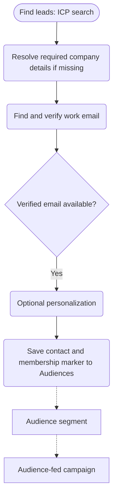

# ICP Sequencer Workflow

Build three connected artifacts: a native search-and-enrichment workflow, a saved people audience segment, and an audience-fed draft campaign with outreach copy and sender settings.

The workflow saves qualified, verified contacts to Audiences; the segment selects them; the campaign handles enrollment from that segment. Do not add an Enroll in Campaign node. Production searching and enrichment belong inside the saved workflow, not local scripts or standalone batches followed by a CSV import. Local configuration files and bounded diagnostic previews are fine.

Keep this skill self-contained in one `SKILL.md`.

## Declared inputs

Reuse anything the user or session already supplied and ask only for genuine gaps, one focused question at a time. Zero, false, and "no personalization" are real answers, not missing inputs.

| Input | What the installer supplies | If it is missing |
|---|---|---|
| Buyer roles and seniority | the target function(s) and seniority the ICP is built around | ask first — the search query cannot be compiled without it |
| Company criteria and signals | size, industry, growth, technographic or other account filters | build a person-level query and disclose that no company criteria were applied |
| Person vs. company geography | whether location means the person or the company HQ, and which regions | apply no geographic filter and say so; do not infer one |
| Exclusions | explicit inclusion/exclusion lists and any accounts to leave out | apply none; never infer exclusions or broaden targeting to hit a count |
| Seller, offer and CTA | who is selling, the offer, the call to action, and substantiated proof for any claim | build the search and enrichment; hold campaign copy until supplied |
| Optional personalization | which facts to enrich and how recent they must be | skip personalization — a valid choice — and connect the email gate straight to writeback |
| Workspace | the intended Clay workspace with Workflows, Audiences and campaigns | stop before creating anything if the target is ambiguous |
| Email verification function | the installed waterfall/verify function to use, if a specific one is required | discover a suitable one in the workspace; if none exists, report the blocker rather than guessing emails |
| Membership design | a dedicated boolean marker field per campaign, or an explicitly identified existing membership design | create a dedicated boolean field for this campaign so other campaigns' membership is not overwritten |
| Sender account | which connected sending identity the campaign should use | ask only when materially different senders are ambiguous; leave the campaign in draft |
| Run scope (at execution) | the whole search or a result limit, and any per-run or per-company caps | run on demand and resolve scope at run time with supported controls; disclose any cap that cannot be enforced |

## What this skill touches

- **Reads**: workspace identity (`clay whoami`); existing workflows, segments and campaigns named by the user, to avoid duplicates; Audiences field definitions; the search trigger's runtime output; the email function's inputs, output and verification contract; connected sender accounts; and the ICP, offer and personalization context the user supplies.
- **Writes**: creates a draft workflow; creates or configures a people audience segment; creates a draft audience-fed campaign (outreach copy, sender settings, segment binding); upserts contact records to Audiences — verified primary email, name, matched-company fields, requested personalization — plus a per-campaign boolean membership marker written only after qualification and email verification; may add compatible Audiences fields the requested build needs; and may append a Marketplace source line to the workflow's description when the installed skill supplies an assigned identity.
- **Never**: enrolls people or sends email on its own; publishes or runs the workflow, launches the campaign, or sends tests without separate authorization; deletes records or clears populated fields (preserves existing values when incoming data is blank); overwrites another campaign's membership on a shared field; guesses a domain or email; imports unrelated contacts to populate a preview; or submits or publishes itself.
- **Halts**: Step 4 sample-review, Step 4 spend-approval, Step 4 send-approval.

## Discovery and artifact links

Run `clay whoami` to identify the workspace. Reuse artifacts explicitly identified by the user or session; inspect them before editing and resolve ambiguous matches before creating duplicates.

Use available Clay skills for workflows, search grammar, action discovery, Audiences, and campaigns as needed. Otherwise use installed `clay ... --help` and live schemas. Current guidance takes precedence over the examples below. Report authentication, network, and unsupported-capability errors accurately rather than treating them as interchangeable.

**Immediately after each artifact is successfully created, send a brief progress update with its name and a clickable `https://app.clay.com` editor link. Do this for the workflow, audience segment, and campaign individually; do not wait until final delivery.** Say it is a draft or still being configured when appropriate. When reusing an artifact, share its link when you identify it.

Prefer the URL returned by Clay. If no URL is returned, construct it from the actual workspace ID and created resource ID:

| Artifact | App URL |
|---|---|
| Workflow | `https://app.clay.com/workspaces/<workspaceId>/terracotta/tc-workflows/<workflowId>` |
| People segment | `https://app.clay.com/workspaces/<workspaceId>/people/audience/<segmentId>` |
| Campaign | `https://app.clay.com/workspaces/<workspaceId>/campaigns/<campaignId>` |

Never substitute API endpoints, guessed IDs, or another workspace's resources. Include all three links again in the final handoff.

## 1. Establish the ICP and offer

Guide the user through a conversational interview: **ask one focused question per message, then wait for the answer before asking the next.** Do not display the full questionnaire or combine several independent questions into one prompt. Reuse information already supplied and skip answered questions. Brief examples can help the user answer.

Start with the buyer's role/function, then resolve missing company criteria, geography, exclusions, offer, and optional personalization in that order. Split broad topics into individual questions when needed. Ask about sender selection later, after discovering connected accounts. Continue independent discovery or draft work between answers when useful.

The following is an internal coverage checklist, not a questionnaire to paste to the user:

- Buyer roles and seniority; company criteria and signals; person geography versus company headquarters; exclusions.
- Seller, offer, call to action, and substantiated product facts or approved proof.
- Optional personalization facts and recency requirements. No extra personalization enrichment is valid.

Summarize the ICP and meaningful assumptions briefly. Default to on-demand configuration when cadence is unspecified. Do not ask for leads per run or contacts per company during the build interview, and do not hardcode a search cap unless the user requests one. The user chooses the entire search or a result limit when running the workflow. If asked to execute it, resolve the run scope then using the supported run controls; honor any limits already supplied. Two emails with a three-day follow-up are reasonable stated defaults, not performance guarantees. Don't broaden targeting to reach a count or override explicit inclusion/exclusion choices.

Compile the query using the current `clay searches query-mode reference`. Keep current-role and company predicates within the same experience expression. Check growth units and company-size buckets: a growth ratio above `1.2` means more than 20%, while a 51–1,000 bucket does not exactly implement 50–1,000. Disclose such boundaries. Criteria requiring further enrichment must be checked inside the workflow; report criteria that cannot be implemented.

## 2. Build the native workflow

Build this as a saved Clay workflow rather than inline conversation work, so it persists as a reusable graph the user can re-run; confirm node syntax on the installed CLI first with `clay workflows nodes --help` (never a hardcoded command form) before creating the nodes shown below.

Show the proposed flow, then create a descriptively named draft workflow following current budget-selection requirements:



The dashed connections describe separate artifacts, not additional workflow nodes. Omit company enrichment when required details are already available, and omit unwanted personalization. Search filters satisfy qualification for the criteria they enforce; general guidance to qualify leads does not require a second node. Add downstream qualification only for criteria the search cannot express. Do not narrow structured seniority matches with extra title-keyword rules. Missing required inputs and unverified emails stop or go to review; those are data-readiness checks, not ICP requalification.

Use a native Find leads trigger containing the actual ICP query. One matching person starts one run. The known source shape is below; verify against current trigger help:

```json
{
  "triggerType": "action_source_scheduled",
  "dataSource": {
    "kind": "cpj_criteria",
    "entityType": "people",
    "dslQuery": "<ICP query>"
  }
}
```

Without `scheduleConfig`, this is on demand despite the type name. Creating the trigger does not execute the search. Read it back for its output schema; saved source configuration may return a source ID rather than echoing the query. If native sourcing is unavailable, report the blocker instead of silently substituting a CSV workflow.

Before finalizing bindings, inspect representative actual outputs from this workflow's search trigger, using existing runs or an authorized small source test. A search preview, declared schema, or another workflow's mappings do not establish runtime values. Check every required email input for presence, type, and nulls. In particular, `matched_experience` may be null even when latest-title/company fields and a Clay company ID are present. Without runtime evidence, mark bindings unverified rather than claiming readiness.

Use title, company, domain, and identifiers from the same employer that satisfied the search. Do not silently fall back to the latest employer: establish that it matches, resolve the matched employment through supported enrichment, or route unresolved records to review and disclose the limitation. When the correct company identifier is available but its domain is missing, enrich that company inside the workflow and gate on the email function's required inputs. Do not discard the whole population merely because the source omits a field that can be enriched. Never guess domains or emails.

Discover a suitable installed email waterfall/function and inspect its inputs, outputs, and verification contract. If it returns only verified work emails, label it “Find and verify work email” without redundant verification. Otherwise add verification and gate on its documented accepted status. Non-empty email alone is not verification. Stop missing or unverified addresses before membership writeback.

Keep optional personalization after qualification and verification where possible. Ground it in returned evidence, preserve sources/dates when relevant, and provide honest missing-value fallbacks. Purchase only facts the copy uses.

A search limit caps candidates, not verified emails or enrollments. Per-person code has no cross-run memory: enforce global/per-company caps only through supported source or persistent mechanisms, and disclose unenforceable limits before running.

### Wiring essentials

Use current workflow data-passing guidance and action schemas. Preserve these distinctions:

- Wire the trigger's returned `workflowNodeId`, not its `resourceId`, through `incomingEdges[].sourceNode`. A trigger has at most one direct outgoing edge.
- Pin upstream values with `inputSchema.properties.<variable>.sourceNodeId` and `sourcePath`; map tool parameters through `tools[].inputMappingConfig`.
- Trigger fields are at the root; tool/function results are under `$.result`. Verify exact output names, including JSONPath brackets for names containing spaces.
- Route condition branches using their actual rule IDs and supported no-match termination. Updating incoming edges replaces the existing set.
- Read saved nodes back: schemas normalize and default mappings may be added on save.

## 3. Connect Audiences and the campaign

Inspect Audiences field definitions. Configure contact upsert with suitable identity lookup keys, verified primary email, name, matched company information, and required personalization. Preserve populated values when incoming data is blank. Selected lookup/write fields each need a corresponding mapping.

Create a dedicated boolean membership field for this campaign and a people segment filtering that field to `true`, unless an explicitly identified existing membership design is suitable. Write the marker only after qualification and email verification. Avoid shared scalar cohort fields that overwrite other campaigns' membership.

Select the marker in `recordFields|selectedRecordFields` and map `recordFields|<markerFieldId>` using the current supported writeback schema. Static `true` can be rejected with “Select a workflow field.” In that case, produce an explicit typed boolean output after the verified-email gate (for example, a small code step returning `campaign_member: true`) and bind that field. Test the producer and persisted mapping; never substitute an assumed tool `success` flag or retain redundant qualification just to supply the marker. Confirm the saved record has the intended value and actually matches the segment. A segment is a filter, not a storage destination; creating it does not populate it.

Create the campaign during the build, rather than leaving it as an undisclosed prerequisite. Inspect current campaign create/update help. Use the audience-fed path and bind the segment through `leadBaseSegmentId` while the campaign is draft. Removing a segment does not convert a campaign to workflow enrollment mode. Do not introduce UI-only campaign creation or placeholder enrollment nodes into this CLI workflow.

Draft and review concise outreach grounded in the established seller and offer. Follow-ups address nonresponders. Use verified field identifiers, readable placeholders, and fallbacks for optional personalization. The workflow must populate all required campaign fields. Select discovered sender accounts from the user's choice or established context; ask when materially different sender identities remain ambiguous.

Save copy and sender settings using supported commands. An empty segment may prevent contact-based preview; disclose that limitation rather than importing unrelated contacts or sending email to test it.

## 4. Validate and hand off

Build drafts by default. Authorization to build covers the requested artifacts and fields; it does not by itself authorize publishing/running the workflow, launching the campaign, or sending tests. Honor execution authorization already given in the session without asking again.

Workflow execution and campaign launch are separate. Leads can be prepared while the campaign is draft. Writes that add members to an active campaign's segment can cause outreach even without an enrollment node, so account for that before execution.

Read back and validate:

| Artifact | Required evidence |
|---|---|
| Workflow | Native search and input bindings persisted; only necessary qualification, input-readiness, and verification gates connected; no-match paths stop; correct upsert and marker; graph validates and canvas is formatted |
| Segment | Filter matches the exact written marker/value and user-specified criteria |
| Campaign | Correct segment binding; saved copy, required fields/fallbacks, and sender configuration; draft status unless otherwise authorized |

Before calling the workflow tested or ready to run at scale, complete a small authorized end-to-end test with the campaign in draft: inspect actual trigger output, resolved email inputs, verified email output, saved contact fields, and segment membership. Use a real candidate from this source; synthetic code inputs and graph validation alone are insufficient. A run that completes by skipping every record does not demonstrate the success path. Investigate all-null inputs or universal skips before increasing volume.

For Find leads, verify which published version the source executes; draft repairs do not fix the live graph until published. Test the final configuration before recommending a larger rerun. A single-node test ends at that node and does not prove downstream writeback or membership. Respect execution approvals: if a test is blocked, inspect and surface the approval request once, keep the result “built but untested,” and stop dependent execution. Parse command errors before extracting IDs or polling; do not retry an approval gate or poll a nonexistent run. Never report contacts processed when nothing ran.

Deliver the three clickable app links, the final flow, important ICP assumptions, configured stages, draft/live status, checks performed, and precise remaining steps such as sender selection, publishing, or launch. An unlaunched campaign does not block lead preparation.

After an authorized run, distinguish candidates, qualification skips, verified emails, saved records, segment members, campaign enrollments, and sent emails using actual evidence. Successful upsert does not prove enrollment or delivery. If blocked, preserve artifact IDs, complete independent work, and give the smallest concrete next step.

## Representative output

Fictional example; real runs use the actual workspace and resource IDs. Nothing is enrolled or sent — all three artifacts are delivered as drafts.

### Build handoff — three connected draft artifacts

Built for a **VP/Head of Engineering at US Series B fintech** ICP:

| Artifact | Status | Link |
|---|---|---|
| Workflow — *ICP Sequencer: VP Eng, fintech* | Draft, graph validated | `https://app.clay.com/workspaces/12345/terracotta/tc-workflows/wf_abc123` |
| People segment — *Fintech VP Eng — campaign member* | Filters `fintech_vpeng_member = true` | `https://app.clay.com/workspaces/12345/people/audience/seg_def456` |
| Campaign — *Fintech VP Eng outbound* | Draft, segment bound via `leadBaseSegmentId` | `https://app.clay.com/workspaces/12345/campaigns/cmp_ghi789` |

- **ICP and assumptions**: VP/Head of Engineering; companies 51–1,000 employees (requested 50–1,000, bucket boundary disclosed); person based in the US; raised Series B. Growth signal expressed as `employee_growth_12mo > 1.2`.
- **Stages configured**: native Find leads trigger (on demand) → company-domain enrichment where missing → find-and-verify work email → verified-email gate → Audiences upsert writing `fintech_vpeng_member = true`. Personalization not requested, so the email gate connects straight to writeback.
- **Enrichment**: a single installed waterfall that returns only verified work emails, so no separate verification node was added.
- **Membership/filter**: dedicated boolean `fintech_vpeng_member`; the segment filters it to `true`; write mapping and segment filter were read back and agree.
- **Status**: all three are drafts. No contacts processed — nothing has run.
- **Remaining to run**: select a sender account, choose run scope or a result limit, run the workflow, then launch the campaign. Each is a separate, explicitly authorized step.

## What good looks like

Three artifacts exist as drafts with their bindings read back and confirmed, and all three links resolve. The segment's filter matches the exact marker field and value the workflow writes — creating the segment did not, by itself, populate it. Only qualified contacts with a verified work email carry the membership marker; records missing a required input or a verified email stop or route to a named review path rather than entering the segment. A small authorized end-to-end test used a real candidate from the source, with the actual trigger output, resolved email inputs, verified email, saved fields and segment membership all inspected — not graph validation or synthetic inputs alone, and not a run that "completed" by skipping every record. Candidates, qualification skips, verified emails, saved records, segment members, campaign enrollments and sent emails are reported as distinct counts from real evidence; a successful upsert is never reported as enrollment or delivery, and nothing is reported as processed when nothing ran. The campaign stays in draft unless its launch was explicitly authorized.

## What this skill does not claim

Stated defaults — two emails with a three-day follow-up — are reasonable starting points, not measured performance guarantees. A search result limit caps candidates, not verified emails or enrollments, and the final enrolled count is not promised from a search-result number. Per-person code nodes have no cross-run memory, so global or per-company caps and one-per-company rules hold only through supported source-level or persistent mechanisms, and any limit that cannot be enforced is disclosed before running rather than faked with a hidden local shortlist. A successful Audiences upsert does not prove segment membership, campaign enrollment, or email delivery — those are separate states. Graph validation and synthetic inputs do not establish the success path; only an authorized live test does. Company-size buckets may not exactly implement a requested range (51–1,000 for a requested 50–1,000), and that boundary is disclosed rather than hidden. An empty technographic or field lookup does not prove a company lacks that technology. The skill builds drafts and never enrolls or sends on its own; it is not a one-time prospect list or CSV-import tool.
